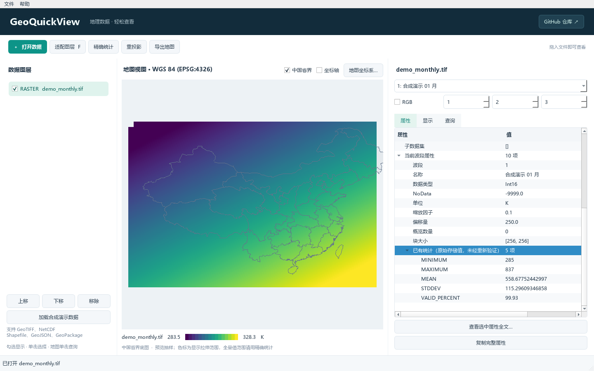
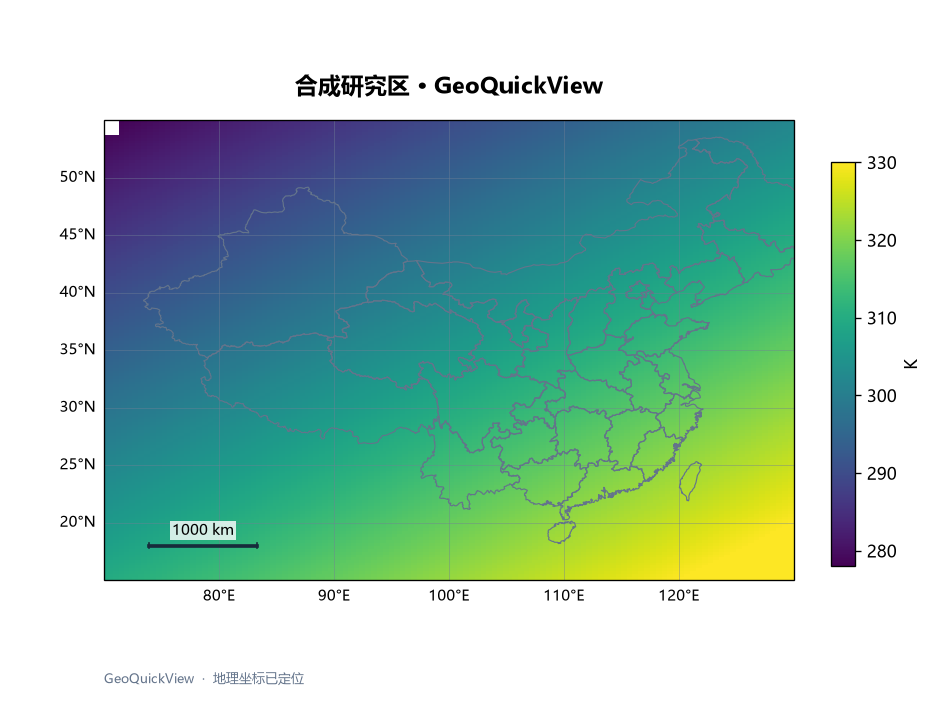

# GeoQuickView

Windows 离线地理数据快看工具。拖入一个文件，查看属性、空间分布和原始像元值；气象 NC 可以直接选择变量、时间和层次。

## 运行

可在 [Windows 构建页面](https://github.com/E-Golem/GeoQuickView/actions/workflows/windows.yml) 的成功任务中下载 GeoQuickView-windows-x64 构建产物。

使用 Windows 64 位便携包时，解压整个目录，双击其中的 **GeoQuickView.exe**。无需安装 Python、Conda、QGIS 或 ArcGIS。也可以把数据拖到窗口，或通过 Windows“打开方式”选择该程序。

发行包保留 _internal 文件夹和第三方许可文件，不要只复制 exe。当前发行包未进行代码签名。

从源码运行：

~~~powershell
conda env create -f environment.yml
conda activate geoquickview
python -m geoquickview
~~~

也可以传入文件：

~~~powershell
python -m geoquickview "D:\data\image.tif" "D:\data\weather.nc"
~~~

## 0.1 功能

| 模块 | 已实现 |
| --- | --- |
| 属性 | 坐标系及完整 WKT、范围、X/Y 分辨率、宽高、数据类型、波段/变量、单位、缩放、NoData、已有统计、矢量字段 |
| 栅格 | 单波段伪彩色、RGB、波段切换、色带/拉伸、透明度、直方图、缩放平移、原始分辨率像元查询 |
| NC | 变量切换、按实际维度生成切片控件、CF 时间/日历标签、0–360 经度转换、纬度方向、缩放与缺失值 |
| 矢量 | Shapefile、GeoJSON、GeoPackage 多图层查看、边界/点线显示、字段属性与附近要素查询 |
| 多图层 | 开关、顺序、透明度；统一地图坐标系并进行预览重投影 |
| 精确统计 | 对选定波段或 NC 当前切片分块全量计算，可取消；不会把结果写回输入文件 |
| 重投影 | 选定/全部栅格波段、NC 当前二维切片输出 GeoTIFF，矢量输出 GeoPackage；进度、取消与独立输出 |
| 简易出图 | 通用研究区模板：标题、可选矢量边界、色标、经纬网、比例尺；范围、配色、字体、尺寸、DPI；PNG/PDF |

界面中的色标、拉伸和直方图来自当前预览抽样；“精确统计”才会扫描所选波段/切片的全部像元。原始存储值、缩放后的物理值、已有缓存统计分别展示。预览重投影不会修改输入数据。

## 适用范围

- 首批验证格式：GeoTIFF、NetCDF、Shapefile、GeoJSON、GeoPackage。其它 GDAL 栅格驱动是否可用取决于发行包；HDF 多子数据集选择、NC 分组浏览尚未提供。
- 支持 NetCDF-3 classic/64-bit offset 与 NetCDF-4；CDF-5 暂不支持。
- 无二维数值变量的 NC 仍可查看和复制全部属性；不提供一维曲线图。
- NC 地图支持可识别空间参照、均匀一维坐标的规则网格。曲线/非结构网格、不规则坐标、重复经度端点会给出说明，不会默认为规则地图。缺少坐标系的数据只在局部坐标中查看，不能直接叠加到已定位地图或重投影。
- 大 TIF 按当前波段/视窗读取；NC 先切片与抽样再读取。缺少概览的压缩文件仍可能需要较多底层 I/O；没有“任意 1 GB 文件瞬间打开”的保证。
- 矢量预览会简化线条，最多 50,000 个要素或 1,000,000 个顶点；触及上限会明确提示显示不完整。导出地图遇到截断时拒绝生成不完整图，需缩小范围。
- 查询原始像元而非预览插值值。当前矢量查询返回点击附近最多 10 个要素；不提供拓扑编辑。
- 输出使用新文件名，避免意外覆盖。独立裁剪、格式转换、重采样和缺失值处理工具按需求安排到后续版本。
- 基础流程不调用在线底图或自动下载边界。边界由用户加载；演示数据是合成数据。

## 验证与打包

~~~powershell
python -m unittest discover -s tests -v
python -m tests.gui_smoke
python -m geoquickview --self-check artifacts\new-self-check
python scripts\build_windows.py
python scripts\verify_bundle.py
~~~

--self-check 输出目录应使用新目录名。打包产生 dist\GeoQuickView\GeoQuickView.exe 和 dist\GeoQuickView-0.1.0-windows-x64.zip。

详见 [验证说明](docs/VALIDATION.md)、[需求及开源调研](docs/planning.md)。测试样例由代码生成，不随仓库上传真实科研数据、虚拟环境或缓存。Windows GitHub Actions 工作流负责测试、打包与便携包自检。

## 技术与许可

Python 3.12、PySide6、GDAL/OGR、xarray/h5netcdf/SciPy、NumPy/PyQtGraph、Matplotlib/Cartopy。查看与出图使用同一组图层、切片、范围与颜色参数。

本项目源码采用 MIT；第三方组件保留各自许可证。发行目录提供 THIRD_PARTY_NOTICES.txt、完整版本/来源记录及包内提供的许可文本。TuiView、viewtif、ncvue、FlashViewer、EOmaps、QGIS 为前期设计调研参考，本项目未复制它们的应用实现。
